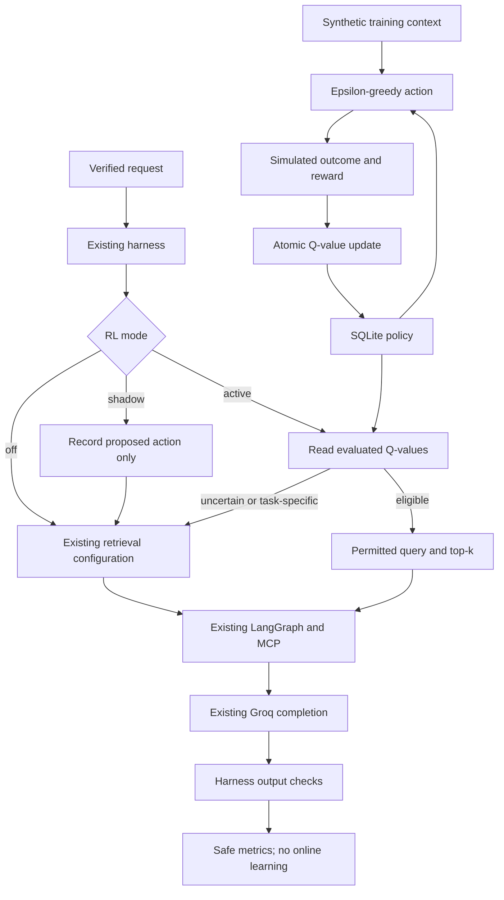

# Phase 6: contextual-bandit viva guide

## What we built

This is a real, small reward-driven learner for retrieval strategy selection. It trains locally on synthetic outcomes and saves Q-values in SQLite. It does not train Groq's weights. Ordinary requests default to `RL_MODE=off`.

Implementation is complete; full asynchronous integration verification remains pending because this environment previously could not complete even a trivial asyncio run. We did not repeat that diagnosis or ask the student to test during implementation.

## Architecture



## Viva questions

1. **Reinforcement Learning (RL)** learns which action to choose from rewards after actions, rather than only following fixed rules.
2. **Contextual bandit:** observes a context, chooses one action, sees one reward and updates its action estimate. Each request is a single decision. It has no long sequence of states or discounted future reward, so this is not full sequential deep RL.
3. **Action:** one permitted retrieval configuration. Actions cannot change user, course, document ownership, provider, authentication or tool permissions.
4. **Reward:** a number from 0 to 1 indicating measured reliability and efficiency. Our synthetic rewards reflect explicitly invented simulation assumptions, not real student outcomes.
5. **Policy:** the rule for choosing actions. Here it uses the estimated reward for each action in the current context category.
6. **Exploration** tries alternatives to learn about them. **Exploitation** chooses an action with the highest current estimated reward.
7. **Epsilon-greedy:** with probability epsilon choose an allowed action uniformly; otherwise choose a highest-Q action. Ties are randomly broken. Training defaults to epsilon 0.2; student requests use epsilon 0, including active mode.
8. **Q-value:** the estimated expected reward for one action in one context category.
9. **Update:** `Q_new = Q_old + alpha * (reward - Q_old)`. With Q_old=0.60, reward=0.90 and alpha=0.25, Q_new=0.60+0.25*(0.90-0.60)=0.675. By default alpha=1/new_observation_count, which makes Q the running average. Optional fixed alpha weights recent observations more strongly and does not equal an all-time average.
10. **Episode:** one synthetic context, action, outcome and policy update. There is no multi-step rollout in this bandit.
11. **Synthetic training:** keeps experiments repeatable and avoids spending Groq tokens or using private student PDFs. The environment intentionally makes follow-ups benefit from contextualization. This assumption must later be checked with consenting, appropriately designed real evaluation.
12. **Baseline:** an alternative policy used for comparison. We use fixed detailed retrieval and random allowed retrieval. The fixed top-five baseline is an experimental baseline; the existing application fallback remains top six.
13. **Improvement:** compare mean reward on identical held-out contexts and potential-outcome draws. Do not update Q-values on held-out rewards. Report higher or lower measured averages without claiming educational or factual improvement. This small run provides no confidence intervals or generalization guarantee.
14. **RAG versus RL:** RAG retrieves passages and generates an answer; RL learns which permitted retrieval configuration to choose. The existing RAG system remains responsible for answering.
15. **Harness evaluation versus learning:** evaluation measures an output. Learning uses measured rewards to change persistent Q-values. Merely logging feedback is not learning. This implementation actually updates Q-values during offline training; real-request outcomes never update policy parameters.
16. **Does this train Groq?** No. No language-model weights are changed. No live model calls are made by the synthetic experiment.
17. **Limitations:** simulated assumptions, coarse features, no semantic factual judge, limited samples, no online learning, no automatic deployment and incomplete async runtime verification. Citation validity only means a cited ID exists in retrieved sources; it does not prove that the passage supports the claim.

## Context and actions

`extract_context` produces only task type (question, summary, quiz or comparison), follow-up boolean and short/long query category (short means at most 12 whitespace-separated words). There are at most 16 categories; 12 are used in training because comparisons are excluded. Features are computed from the current validated question and the presence of existing owned conversation history. Document content never enters policy selection or updates.

| Action | Passages | Query |
|---|---:|---|
| fast | 3 | Current question |
| detailed | 5 | Current question |
| context_aware | 5 | Existing Phase 3C follow-up resolver |

Summary tasks exclude fast retrieval. All comparison tasks and page-scoped requests exclude every RL action and retain their existing retrieval paths. This preserves document-scoped comparison coverage. The learner never constructs filters or changes ownership. The existing API closure, MCP server and harness still check identity and course, and Chroma still filters user/course and selected documents.

In off/shadow mode, the existing contextual query and top-six limit stay unchanged. In active mode, fast/detailed intentionally test the current question without the contextual rewrite; the generation model still has bounded history. This distinction is experimental and can hurt follow-up retrieval. Invalid or unsupported choices always revert to the existing configuration.

## Exact reward formula

Hard gate: reward=0 if authorization is false, execution success is not true, evidence is absent, citation validity is not true, overall evaluation explicitly failed, or structured output is explicitly invalid.

Otherwise use a weighted average of applicable metrics:

- Citation validity: weight 0.35.
- Task completion: weight 0.25.
- Structured-output validity: weight 0.20 only when applicable (quiz).
- Execution success: weight 0.10.
- Efficiency: weight 0.10.

`efficiency = max(0, 1 - (min(duration_ms/30000,1) + min(tool_calls/5,1) + min(model_calls/2,1))/3)`.

`reward = sum(weight * metric) / sum(applicable weights)`.

For ordinary questions, structure is `None`, so divide by 0.80 rather than treating the missing structure check as perfect. Invalid outputs cannot earn credit for being fast. The fixed normalization reflects Phase 5 defaults; it is a simple proxy, not a latency SLA. Feedback endpoints are not added; explicit student feedback remains a possible separate future signal with answer-level deduplication and consent.

The simulator uses one shared quality draw per held-out scenario for every candidate action. The assumed success probability is 0.94 for context-aware follow-ups and 0.40 for other follow-up actions; for non-follow-up long queries/quizzes it is 0.92 for detailed/context-aware and 0.48 for fast; otherwise 0.94. Summary never offers fast. Simulated durations are 1000/2000/2300 ms for fast/detailed/context-aware, with one tool and one model call. These are artificial outcomes supplied to the real reward function, not actual API timings.

## Source files and persistence

- `rl_bandit.py`: `extract_context`, `context_key`, `available_actions`, `select_action`, `calculate_reward`, and `PolicyStore`.
- `PolicyStore.update_policy` validates inputs, opens `BEGIN IMMEDIATE`, reads the previous Q/count, applies the update equation, increments observations and commits together. Concurrent updates do not overwrite an observation. Invalid values fail safely. Updates invalidate the previous evaluation stamp. Connections are closed explicitly.
- `load_policy` validates persisted action names, Q values, counts, epsilon and timestamps. `save_policy` returns the total observation count: updates are already persisted atomically, so no separate global in-memory policy needs flushing.
- SQLite tables: `rl_values(context, action, observations, q, epsilon, updated_at)` and `rl_metadata(name, value)`. Only categorical policy information is stored. No questions, PDF text, user IDs, student names, emails, credentials or access tokens are stored here.
- The storage class defaults to the existing `course_store.DATABASE_PATH`. The CLI deliberately uses a separate ignored **synthetic SQLite file**, using the same database technology; it never opens or resets the student database. Runtime reads do not create policy tables or train the policy.
- `rl_retrieval.py`: `choose_strategy`, `retrieval_configuration`, `finish_decision`. It reads only a policy already evaluated by the experiment runner, with at least five observations for every allowed action in that category. Otherwise it falls back safely. Runtime performs no policy updates in any mode.
- `evaluate_phase6.py`: `synthetic_outcome`, `train`, `evaluate`, `main`. The CLI resets synthetic RL rows only, trains with a seeded RNG, evaluates with a separate seed, compares fixed/random/learned policies, and saves aggregated metrics.
- `phase4_graph.py`: prepare selects a configuration when a harness context is present. Retrieve passes only its query/top-k changes to the same MCP tool. No new graph or tool is introduced.
- `agent_harness.py`: keeps a request-scoped decision and appends a compact RL outcome event after deterministic evaluation. Shadow events contain no reward for the proposed action. Active events may show a reliability reward proxy for the actual action, but policy updates remain disabled.
- `tests/test_phase6.py`: synchronous learning, reward, persistence, concurrency, mode and safety checks.
- `tests/test_phase6_integration.py`: mocked async graph/harness integration checks for off/shadow/active, isolation and tool budgets. No live Groq calls.
- `.gitignore`: excludes `backend/.phase6_experiments/`, including SQLite parameters and JSON metrics.

No schema changes are made automatically to student storage by disabled RL. No frontend changes, credentials, model changes, packages, commits or pushes are needed.

## Safe configuration

Default: `RL_MODE=off`. Unknown mode values also behave as off.

- `off`: no policy database read, no RL events, original retrieval behavior.
- `shadow`: records the proposed choice; executes original retrieval; never credits the proposed choice or updates its Q-value.
- `active`: uses an eligible evaluated policy; greedy only; no online learning. It remains behind the existing harness and MCP authorization checks.

`RL_POLICY_PATH` optionally points to the locally trained synthetic SQLite file. Without it the storage default is the existing application database; absent policy tables cause safe fallback. No synthetic policy is copied into student storage automatically. `RL_MIN_OBSERVATIONS` defaults to 5 and cannot be configured below 1. The CLI stamps a policy as synthetically evaluated only if its held-out mean exceeds the fixed baseline. This is a modest safety gate, not proof of real-world quality.

All real-interaction online learning is intentionally unavailable in this release, even in active mode. A future multi-user service needs an explicit privacy/consent policy and correctly attributed, deduplicated outcome updates before adding it. No feedback endpoint can inflate Q-values here. Policy training is a local developer CLI operation, not an MCP or student-facing tool.

## Commands for later (PowerShell, project root)

```powershell
# Synchronous learning tests; no network or Groq
& .\backend\.venv\Scripts\python.exe -m pytest tests/test_phase6.py -q

# Reset ONLY synthetic experiment rows, train, and evaluate a held-out set
& .\backend\.venv\Scripts\python.exe -m backend.evaluate_phase6 --reset --episodes 1200 --cases 1200 --seed 7 --epsilon 0.2

# Evaluate the saved synthetic policy without learning from test rewards
& .\backend\.venv\Scripts\python.exe -m backend.evaluate_phase6 --evaluate-only --cases 1200 --seed 7

# Async integration and complete regression suite, when testing is resumed
& .\backend\.venv\Scripts\python.exe -m pytest tests/test_phase6_integration.py -q
& .\backend\.venv\Scripts\python.exe -m pytest tests backend/tests -q

# Optional shadow observation, explicitly enabled in this shell only
$env:RL_MODE = 'shadow'
$env:RL_POLICY_PATH = Join-Path (Get-Location) 'backend/.phase6_experiments/synthetic.sqlite3'
& .\backend\.venv\Scripts\python.exe -m uvicorn backend.app:app --host 127.0.0.1 --port 8001
# Stop the server before changing modes. Active requires an explicit decision later:
# $env:RL_MODE = 'active'
# Restore normal behavior:
$env:RL_MODE = 'off'
Remove-Item Env:RL_POLICY_PATH -ErrorAction SilentlyContinue
```

`--reset` has no configurable student database target. It never deletes student tables or Phase 5 results. `latest_metrics.json` is overwritten only inside the synthetic experiment folder. Reproducibility comparisons should start with `--reset`; without it, training intentionally continues the existing policy.

## Measured synthetic experiment

Executed with 1200 training episodes, seed 7, epsilon 0.2; held-out 1200 cases, seed 1007. No held-out Q updates.

| Policy | Mean simulated reward | Held-out updates |
|---|---:|---:|
| Fixed detailed | 0.6364 | 0 |
| Random permitted action | 0.6953 | 0 |
| Learned greedy policy | 0.9004 | 0 |

The learner outperformed both baselines in this particular simulation. Its held-out choices were context_aware in all 1200 cases. Random chose context_aware 436, detailed 482 and fast 282 times; fixed chose detailed 1200 times. This does **not** demonstrate that it learned a different best action for every category; small-sample estimates can favor one action throughout. The policy still learns independent context/action Q-values. The exact results and reward per context are in the ignored JSON metrics file. These scores do not measure factual correctness or actual student success.

## Runtime verification boundaries

The full Phase 4/5 asynchronous suite, real MCP execution and FastAPI startup remain unverified here. Existing unresolved Phase 5 limitations (cooperative cancellation, possible concurrent duplicate provider work, five-question quiz generation) are not redesigned by Phase 6. No live interaction learning, deployment or Phase 7 work has started. The project remains PKR 0; free-provider quotas are still finite.

## Automated checks actually executed

- Phase 6 synchronous tests: 28 passed (20.60 seconds).
- Final combined Phase 6 + synchronous Phase 5 subset: 38 passed, 8 deselected (29.64 seconds). The deselected tests remain in the suite; they were not deleted, skipped, or changed to hide failures.
- Python source compilation passed for all Phase 6 implementation, integration and test files.
- Git whitespace checks passed, with existing line-ending warnings only. Experiment SQLite and JSON paths were verified to be ignored by Git.
- Five new mocked async integration cases were added but were not executed here. No repeat asyncio diagnosis, live API calls, frontend rebuild, server startup or full async suite run was attempted in Phase 6.
- Phase 4 deterministic/output regression subset: 15 passed, 10 deselected (6.84 seconds). These are additional to the 38-test combined subset.
