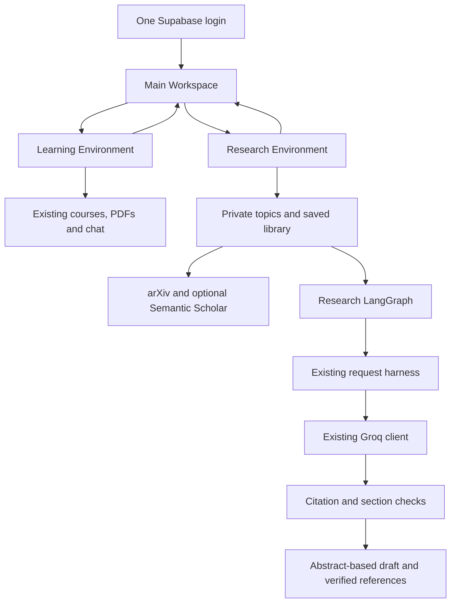

# Phase 7 viva: Learning and Research Environments

## Purpose and navigation

KnowledgePilot now has two environments within one React application and one FastAPI backend. Learning helps a student study their own lectures. Research helps a student discover academic papers, organize reading projects, compare evidence and draft a literature review.

After a normal login, the student sees **Welcome to KnowledgePilot AI** and two equally prominent cards. Enter Learning opens the existing course dashboard. Enter Research opens the dedicated research dashboard. Both have **Back to Workspace** and sign-out actions. Switching environments does not require another login.

Hash routes use the browser's normal history, so Back/Forward work without a new routing dependency. Refresh preserves a valid course/topic route. Examples:

| Route | Page |
|---|---|
| `#/workspace` | Environment selector |
| `#/learning` | Existing course dashboard |
| `#/learning/course/COURSE_ID` | Existing study workspace |
| `#/research` | Research dashboard |
| `#/research/TOPIC_ID` | Private research topic |

An unauthenticated deep link displays login; a valid restored session can reopen that deep link. Unknown routes show a friendly fallback. Existing landing-page anchors and legacy dashboard/workspace hashes remain recognized.

## Architecture



## Authentication and separate data

Both environments use the same Supabase bearer token and existing `get_current_user` dependency. React never supplies an authoritative user ID. Each research route derives ownership from the verified account. Every topic, paper, note, search history and output query checks that owner. Foreign keys also bind papers and notes to their actual owner and topic.

Research has its own tables in the existing SQLite database; course tables, uploaded PDFs, Chroma vectors and saved chats are not moved or recreated. Research migrations use `CREATE TABLE IF NOT EXISTS`.

| Table | Purpose |
|---|---|
| research_topics | Private reading projects |
| research_papers | Saved provider metadata snapshots, owner and topic |
| research_notes | Private notes and latest successful summary |
| research_searches | Successful manual search history |
| research_seen | IDs previously discovered in a private topic |
| research_outputs | Successful summaries, comparisons and reviews |
| research_public_papers | Public metadata cache, without private selections |
| research_http_cache | Bounded, expiring provider-query cache |
| research_provider_state | Shared pacing, cooldown and connection lease |
| research_search_usage | Per-account daily search-attempt count |

Paper metadata is stored as bounded JSON, including title, authors, abstract, year, DOI, original URL and available provider-specific fields. Unique keys prevent duplicate saves within a topic. A save request contains only topic/provider/paper ID; the server obtains metadata from results previously discovered for that account/topic. It cannot save an invented title or another student's private paper record.

## Paper discovery

arXiv is a public research repository. Its API returns Atom XML containing paper metadata. Semantic Scholar is a scholarly discovery service with an academic graph API returning JSON. The optional secondary search uses its public endpoint without requiring an API key. Anonymous availability may vary; failures produce a warning while preserving successful arXiv results.

The server calls only fixed HTTPS endpoints. It encodes query parameters, refuses redirects, bounds response bodies to 2 MB, uses a 10-second socket timeout and never downloads PDFs. XML DTD/entity declarations are rejected. Metadata IDs are validated and original-paper URLs are constructed from those IDs, rather than accepting arbitrary links.

Provider requests use SQLite-backed pacing and a connection lease. arXiv's published rule is at most one request every three seconds and one connection at a time. This prototype coordinates requests across local backend workers sharing SQLite. It is not a distributed deployment rate limiter. Provider HTTP 429 cooldown information is persisted, with no automatic discovery retry or polling. Successful query results are cached for one hour; the query cache holds at most 2000 live entries.

Official documentation reviewed:

- https://info.arxiv.org/help/api/user-manual.html
- https://info.arxiv.org/help/api/tou.html
- https://api.semanticscholar.org/api-docs/graph
- https://webflow.semanticscholar.org/product/api

## Summaries, comparisons and reviews

An **abstract-based summary** uses the available abstract or a bounded excerpt. It does not mean the full paper was read. Summaries request research problem, objective, methodology, findings and limitations. Missing details must be labeled **Not available in the supplied abstract.**

Comparisons accept 2–5 saved papers and request a table, similarities and differences. Literature reviews accept 2–10 and request introduction, background, themes, comparison, supported gaps and conclusion. The server adds the References section from verified metadata. It labels reviews as AI-generated drafts requiring student review, not exhaustive literature searches.

The research graph loads owned papers before any model call. Context is divided across every selected paper, rather than silently dropping later papers. If configured limits cannot cover them, the request is rejected before charging AI quota. No-abstract selections also fail before AI execution.

Generated section headings and numeric citation IDs are checked. Comparisons/reviews must cite every selected paper. Unsupported references and model-written URLs are rejected. The final renderer converts course-style numeric markers into distinct research links such as R1 and R2 and creates original-paper links itself. Provider metadata is escaped before insertion into Markdown references. Plain-text and BibTeX exports use saved metadata and omit unavailable fields instead of inventing authors, years or publication venues.

These checks verify structure and source identity, not factual correctness or semantic support for every claim. The student must review generated claims against the original sources. No full-text research PDF ingestion or paywall access is added in this phase.

## LangGraph and harness

There are small explicit LangGraph workflows for discovery and saved-paper analysis. They use synchronous nodes, which can be tested without the environment's problematic async MCP path. This remains LangGraph, not a new agent framework or a multi-agent system.

The existing `AgentRunContext` gains a research-topic resource scope and a synchronous tool adapter. Research permits only three implemented operations: `search_arxiv_papers`, `search_semantic_scholar`, and `list_saved_research_papers`. Their identity/topic arguments are constructed by the backend, and ownership is checked before execution. These are local Python research tools; they are not falsely reported as MCP protocol calls. The existing authenticated course MCP path stays intact.

Research reuses the harness's tool/model counts, safe errors, traces, context envelope and cooperative deadline checks. Discovery disables retries to preserve provider cooldowns. Analysis uses the existing bounded transient model retry; provider rate limits and authorization errors are not retried. A running synchronous network operation cannot be forcibly cancelled by this harness.

The existing Groq settings and helper are reused. Research analysis normally makes one completion and never exceeds the configured two-attempt model budget. It shares the existing daily AI question quota. Discovery has a separate cap of 30 search attempts per account per day and does not consume AI quota. Replayed successful analysis request IDs return saved output; retried reservations use the existing idempotent quota mechanism. Concurrent duplicate provider work remains a pre-existing limitation.

Other defaults: 10 research topics per account, 100 saved papers per topic, 10 search results, notes up to 5000 characters, abstracts up to 6000 characters, generated answer validation capped at 24000 characters. Research supports up to 10 source passages using `HARNESS_RESEARCH_PASSAGES` (maximum 10), within the existing total character budget. Course context settings are unchanged.

Traces contain operation names, status, duration, counts and safe error categories, not complete questions, abstracts, notes, prompts, credentials or access tokens. Private research search history is stored only under its owner and is not an execution log.

## RL and n8n

The Phase 6 bandit is specific to course-document retrieval. It is not used to choose research APIs, papers or providers. `RL_MODE=off` remains the default; research introduces no real-student online learning.

n8n is optional future developer integration. It is not installed, started or required here. Manual checking works through Python and SQLite. A future local workflow should use mock data first and require its own authentication and license review; no student-facing workflow editing or paid n8n Cloud is introduced.

## Tracking and cost

Check for New Papers performs a manual search and compares returned IDs against IDs previously discovered in that topic. Newly discovered means new to this private topic, not necessarily newly published. The first check can mark all returned IDs as newly discovered. The last successful check is stored; failed checks do not overwrite it. Cached results are identified. There are no background alerts when the app is closed.

No paid research database, hosted MCP service, model-training platform, monitoring product, subscription, credit card or deployment is introduced. No packages were installed. Groq and Supabase retain their existing finite free-tier limits. This phase remains PKR 0; future public deployment still needs a separate resource and hosting review.

## Important files and functions

- `frontend/src/pages/Environments.jsx`: two premium cards and entry buttons.
- `frontend/src/services/routes.js`: `parseRoute`, `routeFor`, `visiblePage` implement simple protected hash routes.
- `frontend/src/App.jsx`: restores shared authentication and renders the chosen environment.
- Existing Dashboard, Workspace and Landing: navigation additions reuse current learning components.
- `frontend/src/pages/Research.jsx`: topics, discovery, library, selection, notes, tracking and saved drafts; no new state library.
- `frontend/src/services/research.js`: authenticated research API helpers.
- `backend/research_store.py`: additive tables and owner-scoped persistence functions.
- `backend/research_providers.py`: metadata parsers, fixed endpoint requests, cache and persistent pacing.
- `backend/research_quality.py`: bounded abstract evidence, section validation, safe references and BibTeX export.
- `backend/research_graph.py`: `build_discovery_graph` and `build_research_graph`.
- `backend/research_api.py`: shared-auth routes, analysis replay, quota callback and safe responses.
- `backend/app.py`: registers research tables/routes using the existing quota function.
- `backend/agent_harness.py`: research scope and `tool_sync`, preserving existing course controls.
- `tests/test_phase7.py`: mocked providers/models and temporary SQLite tests.
- `frontend/test-phase7.mjs`: server-render and route/callback checks; these are not browser interaction tests.

## Commands for later

From the project root in PowerShell:

```powershell
& .\backend\.venv\Scripts\python.exe -m pytest tests/test_phase7.py -q
& .\backend\.venv\Scripts\python.exe -m pytest tests backend/tests -q
& .\backend\.venv\Scripts\python.exe -m uvicorn backend.app:app --host 127.0.0.1 --port 8001
```

In another terminal:

```powershell
cd frontend
node test-phase7.mjs
npm run build
npm run dev
```

Open the Vite URL shown in the terminal. Sign in, select Learning or Research, and use Back to Workspace to switch. The full async suite, live provider/model behavior and authenticated browser flow must not be described as verified unless actually executed. The student can resume manual testing later.

## Observed validation results

- Final Phase 7 backend suite: **36 passed** in 26.76 seconds, using mocked APIs/models and temporary SQLite.
- Final frontend render/route/button-callback checks: **18 passed**. These verify generated components and navigation functions, not actual browser interaction.
- Final React production build: **passed** in 4.25 seconds. Existing dependency directive warnings and a bundle-size warning remain.
- Python source compilation and Git whitespace checks: **passed**; only line-ending warnings were reported.
- Selected Phase 4–6 regressions earlier in this implementation: **53 passed, 18 deselected** in 30.04 seconds. The full async suite was not rerun because its sandbox restriction was already established.
- The in-app browser could not reach the local Vite server (connection timeout). Authenticated browser interaction, mobile screenshots, live arXiv/Semantic Scholar responses, live Groq generation and FastAPI startup remain unverified here. No live Groq calls were made.

Implementation and documentation are complete. Full end-to-end runtime verification is a separate pending status. Existing uncommitted work was preserved; no database/PDF/vector/chat reset, environment recreation, deployment, automatic commit or push was performed.
